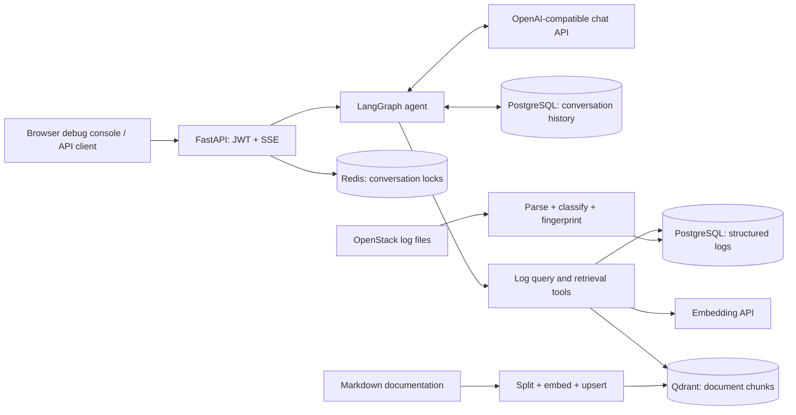

# Mini Agent — AI Log Analysis Assistant

A Python backend that helps engineers investigate OpenStack errors through natural-language questions, structured log queries, and retrieval from operational documentation.

The agent aggregates recurring errors, retrieves a few representative records when needed, and can search a documentation knowledge base to inform troubleshooting. A browser debug console exposes tool progress and streamed responses.

**Portfolio focus:** LLM tool calling · LangGraph workflows · RAG · FastAPI streaming · PostgreSQL · Redis · Qdrant

## Use case

Operations teams often need to connect three pieces of information: which errors occur most often, what the underlying records say, and what the relevant documentation recommends. This project brings those steps into one conversational workflow.

Example questions for an imported dataset:

> Summarize the main OpenStack errors from May 14–16, 2017.
>
> Show representative records for the most frequent error group.
>
> Search the knowledge base for troubleshooting guidance related to this error.

These are example prompts, not recorded results. Answers depend on the imported logs, indexed documents, and configured model. The agent's built-in instructions and debug interface currently use Chinese; English prompts depend on the selected model's language support.

## Implemented capabilities

| Capability | Implementation | Practical purpose |
| --- | --- | --- |
| Agent orchestration | LangGraph model/tool loop with a finalization path | Coordinate queries and follow-up reasoning |
| Error aggregation | PostgreSQL grouping by normalized SHA-256 error fingerprints | Summarize recurring errors before retrieving raw records |
| Targeted evidence | Retrieve up to 3 records for a selected fingerprint and time range | Inspect examples while limiting context size |
| Documentation retrieval | Embeddings and Qdrant similarity search | Return relevant document content, source paths, headings, and scores |
| Streaming API | FastAPI Server-Sent Events (SSE) | Show tool status and response text as work progresses |
| Conversation persistence | PostgreSQL JSONB message records and turn statuses | Restore successful conversation history and retain tool interactions |
| Context compression | Cumulative summaries plus recent complete turns | Keep longer conversations within a configurable context budget |
| Authentication | JWT bearer tokens and Argon2 password verification | Authenticate chat requests and check conversation ownership |
| Request coordination | Redis conversation locks with expiring ownership tokens | Prevent overlapping requests for the same conversation |
| Failure handling | Request timeouts, cancellation tracking, and bounded cleanup | Record unsuccessful turns and release resources |

## Architecture



The system prompt directs the agent to query error summaries first and request examples only when the summary is insufficient. Knowledge retrieval is available as an additional tool. This sequence is guided by instructions rather than enforced as a fixed graph path.

### Engineering details

- **Bounded log queries:** a maximum 7-day window, up to 10 summary groups, and up to 3 detail records with raw excerpts capped at 1,500 characters each.
- **Matching evidence boundaries:** detail queries reuse the summary's exact start and exclusive end timestamps.
- **Structured error grouping:** rule-based classification normalizes dynamic values before fingerprinting. A group identifies similar errors; it does not establish a root cause.
- **Durable conversation state:** human, assistant, and tool messages are stored with turn status. Successful turns feed restored context; failed, timed-out, and cancelled turns are excluded.
- **Context management:** compression triggers at 8,000 estimated tokens and targets 4,000 while retaining at least two recent turns. Token estimates use the BGE-M3 tokenizer rather than the chat model's exact tokenizer.
- **Resource lifecycle:** application startup and shutdown manage the asynchronous PostgreSQL pool and Redis client. Conversation summaries are generated without holding a database connection.
- **Conservative failure instructions:** the agent is instructed to disclose missing evidence and tool failures. These instructions reduce risk but do not guarantee factual accuracy.

## Technology stack

- Python 3.12, FastAPI, Uvicorn
- LangGraph, LangChain Core, OpenAI-compatible chat and embedding clients
- PostgreSQL with Psycopg async connection pooling
- Qdrant for vector retrieval; Redis for conversation locks
- PyJWT and pwdlib with Argon2
- Hugging Face Transformers tokenizer and PyYAML for document processing
- Python `unittest` with mocked external dependencies

Pinned Python dependencies are listed in [requirements.txt](requirements.txt). Chat and embedding model identifiers are configured in [config.example.ini](config.example.ini); availability depends on your API provider.

## Local setup

Run commands from the repository root. You need Python 3.12, running PostgreSQL, Redis, and Qdrant services, and an API provider supporting chat tool calling and embeddings. Setup and ingestion require network access to download dependencies/tokenizer files and call the model provider.

### 1. Install dependencies and configure services

```bash
python3.12 -m venv .venv
source .venv/bin/activate
python -m pip install -r requirements.txt
cp config.example.ini config.ini
python -c "import secrets; print(secrets.token_urlsafe(48))"
```

Edit `config.ini` with your API key, model names, service connection settings, and a separate JWT secret generated by the last command. `config.ini` is ignored by Git. To use another configuration path, set `MINI_AGENT_CONFIG` before starting the process.

The code loads the BGE-M3 tokenizer from the local Hugging Face cache. Download it once before starting the application or document ingestion:

```bash
python -c "from transformers import AutoTokenizer; AutoTokenizer.from_pretrained('BAAI/bge-m3')"
```

### 2. Initialize PostgreSQL

Create a database and database user first. Replace the connection values below with those configured in `config.ini`; `psql` does not read that file.

```bash
psql -h localhost -p 5432 -U postgres -d mydb -f tables.sql
psql -h localhost -p 5432 -U postgres -d mydb -f log_ingestion/schema.sql
```

Apply `tables.sql` once to a fresh database; it is not an incremental migration system.

There is no signup endpoint. To create a local demo account, run this Python snippet in the activated environment; it prompts for a password and stores its hash:

```python
from getpass import getpass
from uuid import uuid4

from pwdlib import PasswordHash
from log_ingestion.postgres_writer import get_postgres_connection

username = input("Demo username: ").strip()
password_hash = PasswordHash.recommended().hash(getpass("Demo password: "))
with get_postgres_connection() as connection:
    connection.execute(
        "INSERT INTO users (id, username, password_hash) VALUES (%s, %s, %s)",
        (uuid4(), username, password_hash),
    )
```

### 3. Import logs and index documentation

See [data/DOWNLOADS.md](data/DOWNLOADS.md) for dataset sources, expected locations, and documentation attribution notes. The implemented parser targets the bundled OpenStack dataset format, including multiline records; other formats need their own parsers.

The log importer expects these extracted files:

```text
data/raw_logs/full/openstack/openstack_abnormal.log
data/raw_logs/full/openstack/openstack_normal1.log
data/raw_logs/full/openstack/openstack_normal2.log
```

```bash
python -m log_ingestion.ingest
```

Log imports append records; running the importer again duplicates those records unless you manage existing data yourself.

For a new Qdrant collection, the included helper creates a 1,024-dimensional collection with cosine distance:

```bash
python qdrant_test.py
python -m ingestion.qdrant_writer
```

Run the collection creation helper only when the configured collection does not already exist. Its dimension must match your embedding model; adjust the helper if you use a different dimension.

The document importer currently indexes the seven OpenStack Markdown files listed in `MARKDOWN_PATHS` in `ingestion/qdrant_writer.py`. Kubernetes and Kafka documents are also present, with their importer entries commented out. Edit that list to choose documents. Chunks retain source paths and heading metadata; stable point IDs let repeated imports overwrite matching chunks. Removing or rechunking documents may require explicitly deleting obsolete points.

### 4. Start the API and try the demo

```bash
uvicorn app.main:app --reload --host 127.0.0.1 --port 8000
```

- Debug console: [http://127.0.0.1:8000/debug](http://127.0.0.1:8000/debug)
- Interactive API docs: [http://127.0.0.1:8000/docs](http://127.0.0.1:8000/docs)

Log in with the demo account, use a conversation UUID, and ask about a date range present in your imported logs. New conversation IDs are created on the first chat request. Keep the same ID for follow-up questions; use a new UUID for a separate investigation.

For a portfolio walkthrough, demonstrate an error summary, a follow-up requesting representative records, and a request for relevant documentation. The debug console shows tool progress and streamed text. Use your actual run as evidence; this repository does not include measured accuracy or latency results.

## API reference

| Method | Route | Purpose |
| --- | --- | --- |
| `POST` | `/login` | Verify username/password and return an 8-hour JWT as `token` |
| `POST` | `/chat` | Accept a question and conversation UUID; stream SSE events; requires a bearer token |
| `GET` | `/debug` | Open the browser debug console |

Login request:

```json
{"username": "demo", "password": "your-demo-password"}
```

Chat request with `Authorization: Bearer <token>`:

```json
{
  "question": "Summarize OpenStack errors from 2017-05-14 to 2017-05-16.",
  "conversation_id": "83e169fa-67a9-44bc-90a4-cf397b8b82aa"
}
```

SSE event types are `status` (tool progress), `message` (response text chunks), `done` (completion), and `error` (failure). Clients should handle authentication/validation HTTP errors before reading the stream, and `error` events after streaming begins. Use a streaming POST client such as browser `fetch`; native `EventSource` does not support this POST body and authorization-header pattern.

## Tests

```bash
MINI_AGENT_CONFIG=config.example.ini python -m unittest discover -s tests -v
```

The suite mocks external services and model calls. It covers async pool lifecycles, tool execution, SSE event flow, summary boundaries, skipped tool-call pairing, timeout/cancellation cleanup, JWT validation, conversation ownership, and matching log query time ranges. These are regression tests, not live-service integration tests or an evaluation of diagnosis quality.

## Repository map

```text
app/main.py                    Authentication, API routes, and application lifecycle
app/debug.html                 Browser login and SSE debug console
agent.py                       LangGraph workflow, streaming, locks, and finalization
tools.py                       Error summaries, representative logs, and RAG search
conversation.py                Message persistence and context compression
database.py                    PostgreSQL and Redis resource management
config.py                      Configuration loading
errors.py                      Error mapping for streamed failures
log_ingestion/                 OpenStack parsing, classification, schema, and imports
ingestion/                     Markdown processing and Qdrant ingestion
data/DOWNLOADS.md              Dataset and documentation source inventory
tables.sql                     Conversation and user schema
tests/                         Mock-based regression tests
```

## Scope and extension points

This is a portfolio backend with a local debug interface. It demonstrates agent orchestration, data ingestion, retrieval, persistence, authentication, and streaming in one application.

- Log queries currently access a shared log dataset. Conversation ownership is checked, but log access is not isolated by customer or tenant.
- Retrieval returns source metadata to the model; answer-level citations and diagnostic correctness are not automatically verified.
- The system suggests analysis and troubleshooting guidance; it does not execute remediation commands.
- Additional log sources require parsers and ingestion configuration. Deployment automation, monitoring, rate limiting, and a customer-facing interface are extension work.
- The repository does not include production deployment claims, client outcomes, performance benchmarks, or a top-level software license. Third-party datasets and documentation retain their own usage terms.

For freelance project discussions, this codebase provides concrete examples of Python AI backend development, tool-calling agents, document retrieval pipelines, streamed APIs, and persistent conversational workflows.
